# CCS Attendance — User Manual

**College of Computer Studies** · Version 1.0 · October 15, 2026

QR-based attendance, penalty tracking, finance, and clearance for Students, Officers, and Governors.

| Role | What you can do |
| --- | --- |
| 🟦 **Student** | Sign in, show your QR, track attendance, penalties, and clearance. |
| 🟩 **Officer** | Run Events, scan at the booth, record payments, check clearance, generate reports. |
| 🟪 **Governor** | Everything an Officer does, plus Semesters, Programs, Officers, and audit. |

## Contents

1. [Introduction](#1-introduction)
2. [Getting Started](#2-getting-started)
3. [Roles and Permissions](#3-roles-and-permissions)
4. [System Overview](#4-system-overview)
5. [Data Flow](#5-data-flow)
6. [Student Guide](#6-student-guide)
7. [Officer Guide](#7-officer-guide)
8. [Governor Guide](#8-governor-guide)
9. [Attendance, Penalty, and Clearance Rules](#9-attendance-penalty-and-clearance-rules)
10. [Troubleshooting and FAQ](#10-troubleshooting-and-faq)
11. [Glossary](#11-glossary)

---

## 1. Introduction

CCS Attendance replaces paper sign-in sheets for College of Computer Studies Events. Students show a personal QR code at the Event booth, Officers scan and approve it on an Android phone, and the system works out attendance, penalties, payments, and end-of-semester clearance automatically.

### 1.1 What the app does

- **QR attendance:** each Student has a QR pass. Officers scan it for Time-in and Time-out, for the AM and PM halves of each Event.
- **Automatic penalties:** a missed half-day is charged automatically from the Event's penalty amount. Nobody types penalties in by hand.
- **Payments and finance:** Officers record Penalty and SAF Fee payments and department Expenses. The Department Fund balance is always up to date.
- **Clearance:** a Student is clearance-ready when their outstanding balance is ₱0, so an Officer can sign their clearance paper.
- **Reports:** Officers can generate PDF reports per Event, per Student, per Semester, and for finances.
- **Offline booth:** scanning keeps working without internet. Decisions are saved on the phone and sync when the connection comes back.

### 1.2 How to use this manual

The manual is organized by role. Each role has a color marker, used in headings, tables, and diagrams:

| Marker | Role | Read these chapters |
| --- | --- | --- |
| 🟦 Blue | Student | 2, 3, 6, 9, 10 |
| 🟩 Green | Officer | 2, 3, 6, 7, 9, 10 |
| 🟪 Purple | Governor | All chapters |

Chapters 4 and 5 (system and data flow) are for readers who want to know how the parts fit together, such as advisers, auditors, and the next development team.

### 1.3 Diagram legend

| Shape / color | Meaning |
| --- | --- |
| Blue box | A step done by a Student |
| Green box | A step done by an Officer (Governors can do it too) |
| Purple box | A step only a Governor can do |
| Yellow diamond | A decision or check |
| Red box | A rejection, penalty, or irreversible step |
| Light green box | A successful end state |
| Cylinder | Stored data |

---

## 2. Getting Started

> ⬜ **ALL USERS** — This chapter applies to everyone.

### 2.1 What you need

| Item | Who needs it | Notes |
| --- | --- | --- |
| School Google account (@gbox.ncf.edu.ph) | Everyone | Personal Gmail accounts are refused at sign-in. There are no passwords to remember. |
| Web browser (phone or computer) | Everyone | Any up-to-date browser. Officer desk work (attendance grid, Finance, Reports) is easiest on a computer. |
| CCS Attendance Android app | Officers & Governors | The booth scanner. Students who sign in to the app are turned away; Students use the web app. |
| Your name on the Enrollment Roster | Students | The department imports the semester's roster. You can only claim a spot that exists on it. |

### 2.2 Signing in

1. Open the CCS Attendance web address and choose **Sign in**.
2. Choose **Continue with Google** and pick your **@gbox.ncf.edu.ph** account. First-time and returning users use the same button; there is no separate registration page.
3. If this is your first sign-in, you go to **Onboarding** (section 2.3). Otherwise you land on your home page: **My Attendance** for Students, **Dashboard** for Officers and Governors.

### 2.3 First-time onboarding (claiming your roster spot)

When you first sign in you are a **Pending Student**. You have a verified school identity but no Student record yet, so you cannot have a QR or attend Events. Onboarding creates your record from the Enrollment Roster.

1. The **Confirm your Student ID** dialog shows the name and email you signed in with.
2. Enter your Student ID exactly as on your school record (for example **24-00136**).
3. Choose **Claim my roster spot**.
4. If your school email or your Student ID plus Google first and last name match a roster entry, your Student record is created with the roster's Program and Section. You go straight to **My Attendance**, and your QR pass is ready.

> [!IMPORTANT]
> A roster spot can be claimed only once. If the system says your Student ID is already taken or does not match, do not create another account. Ask an Officer to check the roster.

> [!NOTE]
> Governors are set up the same way. If the school email is on the department's Governor list when the record is created, the account becomes a Governor automatically.

### 2.4 Navigating the web app

A floating navigation bar at the top shows only the pages your role may open. On a phone, extra items are under the **More** menu. Use the **Log out** button in the bar to sign out.

---

## 3. Roles and Permissions

There are three roles. Each role builds on the one before it: an Officer can do everything a Student can, and a Governor can do everything an Officer can.

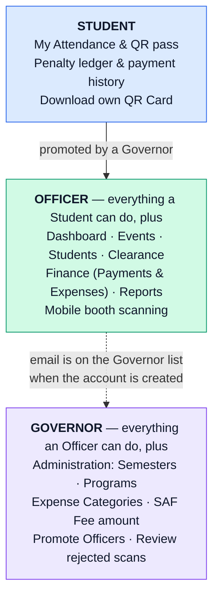

*Figure 1. Role hierarchy. Each role inherits everything from the role above it.*

### 3.1 Capability matrix

| Capability | 🟦 Student | 🟩 Officer | 🟪 Governor |
| --- | :---: | :---: | :---: |
| View own QR pass, attendance, penalties, payments | ✓ | ✓ | ✓ |
| Download own QR Card | ✓ | ✓ | ✓ |
| Operations Dashboard | — | ✓ | ✓ |
| Create, edit, and delete Events (all Events are shared) | — | ✓ | ✓ |
| Scan attendance with the mobile booth app | — | ✓ | ✓ |
| Correct attendance (Present / Absent) | — | ✓ | ✓ |
| Record Penalty and SAF Fee Payments | — | ✓ | ✓ |
| Record and void Expenses | — | ✓ | ✓ |
| Check Clearance readiness | — | ✓ | ✓ |
| Edit a Student's ID and Program; print QR Cards | — | ✓ | ✓ |
| Generate PDF Reports | — | ✓ | ✓ |
| Create, edit, and close Semesters; set the SAF Fee | — | — | ✓ |
| Manage Programs and Expense Categories | — | — | ✓ |
| Promote Students to Officer | — | — | ✓ |
| Review rejected scans (web audit page) | — | — | ✓ |

### 3.2 Pages each role sees

| Page | What it is for | 🟦 Student | 🟩 Officer | 🟪 Governor |
| --- | --- | :---: | :---: | :---: |
| My Attendance | Your QR pass, sessions, ledger, payments | ✓ | ✓ | ✓ |
| Dashboard | Semester status, attendance rates, recent scans | — | ✓ | ✓ |
| Events | Create and manage Events; open attendance grids | — | ✓ | ✓ |
| Students | Search Students, fix details, QR Cards | — | ✓ | ✓ |
| Clearance | Check whether a Student owes anything | — | ✓ | ✓ |
| Finance | SAF Fees, Expenses, Department Fund | — | ✓ | ✓ |
| Reports | Generate PDF reports | — | ✓ | ✓ |
| Administration | Semesters, Programs, Categories, Officers | — | — | ✓ |

> [!NOTE]
> The server checks permissions on every action, not just the menu. Typing a page address you are not allowed to use sends you back to your home page.

### 3.3 Becoming an Officer or Governor

- **Officer:** a Governor promotes an existing Student from the Administration page. Sign out and back in (or refresh) to see the new menu items.
- **Governor:** decided once, when the account is first created, from the department's Governor email list. Changing the list later does not change existing accounts.
- **Demotion** of an Officer is not supported yet. Booth decisions stored on an Officer's phone cannot be handed to someone else safely.

---

## 4. System Overview

### 4.1 System architecture

CCS Attendance has two apps and a set of cloud services. Students, Officers, and Governors use the **web app** in any browser. Officers and Governors also use the **Android booth app** for scanning. Both apps talk to one **API**, which holds every business rule and permission check and is the only part that reads and writes the database.

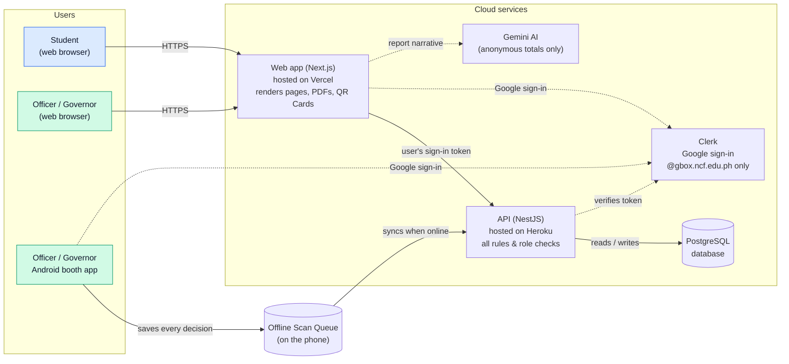

*Figure 2. System architecture: who talks to what.*

| Component | Role in the system |
| --- | --- |
| Web app (Vercel) | Shows pages to every role, forwards actions to the API with the user's sign-in token, and renders PDF Reports and QR Cards. |
| Android booth app | Camera scanner for Officers and Governors. Saves every decision in an on-phone Offline Scan Queue before sending it. |
| API (Heroku) | The single place where rules and role permissions are enforced: attendance, penalties, payments, clearance, and administration. |
| PostgreSQL database | Stores Students, Events, Scans, Attendance Sessions, Penalties, Payments, and Expenses. |
| Clerk + Google | Sign-in. Only @gbox.ncf.edu.ph Google accounts are allowed. |
| Gemini AI | Writes the narrative paragraph in Reports. It only receives anonymous totals, never names or Student IDs. |

### 4.2 System flow: from Event to clearance

The end-to-end cycle of a semester, across all three roles:

| # | Who | What happens |
| :---: | --- | --- |
| 1 | 🟪 Governor | Opens a Semester (start and end dates) and sets the SAF Fee amount. |
| 2 | 🟦 Student | Signs in, claims a roster spot, and gets a QR pass. |
| 3 | 🟩 Officer | Creates an Event inside the Semester: date, whole-day or half-day, and penalty amount. |
| 4 | 🟩 Officer | Scans Students in and out at the booth. Decisions sync to the API. |
| 5 | ⬜ System | Works out each Attendance Session and charges Penalties for absences. |
| 6 | 🟩 Officer | Fixes attendance mistakes, records Payments and SAF Fees, and logs Expenses. |
| 7 | 🟩 Officer | At semester end, checks Clearance and signs the paper for Students with a ₱0 balance. |
| 8 | 🟪 Governor | Closes the Semester. Events freeze, but attendance fixes and Payments remain possible. |

### 4.3 Data model

The main records the system keeps and how they relate.

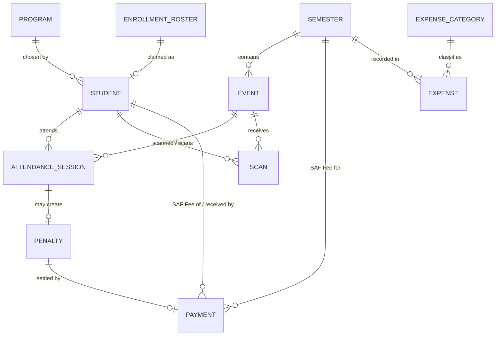

*Figure 3. Entity-relationship diagram.*

| Record | Meaning |
| --- | --- |
| Enrollment Roster | The semester's imported list of enrolled people, including those who have not signed in yet. |
| Student | A person who claimed a roster spot. Holds role (Student, Officer, or Governor), Student ID, and Program. |
| Semester | A date range. Only one can be open at a time. |
| Event | One calendar day of activity inside a Semester, whole-day or half-day, with a penalty amount. |
| Scan | One approve or reject decision from the booth, with the moment it was captured. |
| Attendance Session | One half (AM or PM) of an Event for one Student. Needs Time-in and Time-out to count as present. |
| Penalty | The peso charge for one absent Attendance Session. Calculated automatically. |
| Payment | Settles one Penalty or one SAF Fee in full. Payments can be voided but never edited. |
| Expense / Category | Department spending, classified by a Governor-managed category. |

---

## 5. Data Flow

The data flow diagram shows how information moves between the three roles (rectangles), the six main processes (circles), and the four data stores (cylinders).

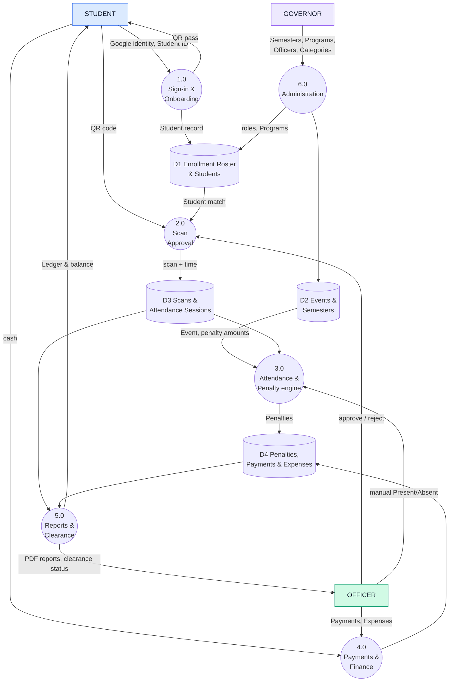

*Figure 4. Data flow diagram (level 1).*

| Process | Inputs | Outputs |
| --- | --- | --- |
| 1.0 Sign-in & Onboarding | Google identity, Student ID | Student record, QR pass |
| 2.0 Scan Approval | QR code, Officer's approve/reject, roster match | Scan with capture time |
| 3.0 Attendance & Penalty engine | Scans, manual corrections, Event penalty amounts | Attendance status, Penalties |
| 4.0 Payments & Finance | Cash from Students, Officer-entered Payments and Expenses | Payment and Expense records, Department Fund |
| 5.0 Reports & Clearance | Attendance, Penalties, Payments | PDF Reports, clearance status, Student ledger |
| 6.0 Administration | Governor settings | Semesters, Programs, Officer roles, Categories |

> [!NOTE]
> Privacy: the QR code holds only your name, Student ID, and Program. Reports send only anonymous totals to the AI service. Names and IDs are added to the PDF afterwards and never leave the system.

---

## 6. Student Guide

> 🟦 **STUDENT** — Everything in this chapter is available to every signed-in Student (and to Officers and Governors for their own records).

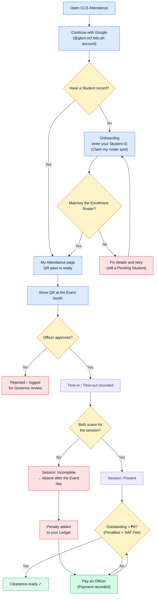

*Figure 5. Student user flow: from sign-in to clearance.*

### 6.1 My Attendance page

After you sign in, the app opens **My Attendance**. It has four parts:

| Section | What you see |
| --- | --- |
| Student QR pass (Digital Pass) | Your personal QR code, with your name, Student ID, and Program. Show it at Event booths. |
| Penalty ledger & clearance standing | Total charged this Semester, your outstanding balance (Penalties plus SAF Fee), and whether you are clearance-ready. |
| Attendance session history | Every Event in the open Semester, with AM and PM status: Present, Incomplete, or Absent. |
| Penalty payment history | Payments recorded for you: amount, date, and the Officer who received it. |

### 6.2 Using your QR at an Event

1. Open **My Attendance** on your phone, or bring a printed **QR Card**.
2. **Wear your school ID.** The Officer compares the details on screen with your school ID, not with the QR.
3. Show the QR when you arrive (**Time-in**) and again when you leave (**Time-out**). Whole-day Events need both scans in the morning (AM) and again in the afternoon (PM).
4. Once the Officer approves, the scan counts even if the booth phone is offline. It syncs later with the original time.

> [!TIP]
> No phone? Download your QR Card from My Attendance and print it, or ask an Officer to print one. The card is only a copy of your QR. You still need your school ID.

> [!IMPORTANT]
> If an Officer corrects your Student ID or Program, every QR Card printed before the change stops working. Download a new one.

### 6.3 Understanding penalties

- A session counts as **Present** only with **both** a Time-in and a Time-out.
- Missing one scan makes the session **Incomplete** on the Event day and **Absent** after that day.
- Each absent session is charged that Event's penalty amount. Missing a whole-day Event charges both halves.
- If you register partway through the Semester, you are still charged for **every** Event in that Semester, including those before you signed up.
- The **SAF Fee** (Student Assistance Fund, set by the Governor each Semester, typically ₱500) is owed once per Semester and must be paid in full.
- Penalties update automatically when an Officer corrects attendance. Ask an Officer if you think a record is wrong.

### 6.4 Paying and getting cleared

1. Pay an Officer in person. The Officer records the Payment, and it appears in your payment history.
2. When your outstanding balance (Penalties plus SAF Fee) reaches **₱0**, My Attendance shows you as clearance-ready.
3. Bring your clearance paper to an Officer. They confirm your status on the Clearance page and sign it.

---

## 7. Officer Guide

> 🟩 **OFFICER** — Available to Officers and Governors. Officers share every Event: any Officer can manage any Event.

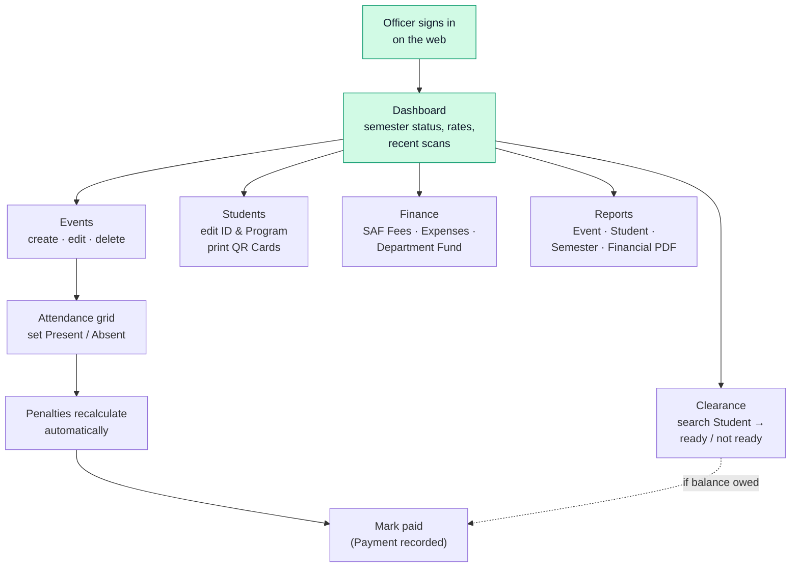

*Figure 6. Officer desk flow (web app).*

### 7.1 Dashboard

Your home page shows the open Semester, the active attendance session, overall attendance rate, events hosted, resolved session counts, and recent scans with their sync status. Use the refresh button to reload the numbers.

### 7.2 Managing Events

Open **Events** to see every Event in the Semester and to create new ones.

1. Choose **Create Event**.
2. Enter the **Name** and **Date**. The date must fall inside the open Semester. A multi-day activity is entered as one Event per day (for example, "Workshop Day 1" and "Workshop Day 2").
3. Pick the **Type**: whole-day (AM and PM sessions) or half-day (one session).
4. Set the **Half-day absence penalty (₱)**. A whole-day absence costs twice this amount.
5. Confirm **Create this Event?**.

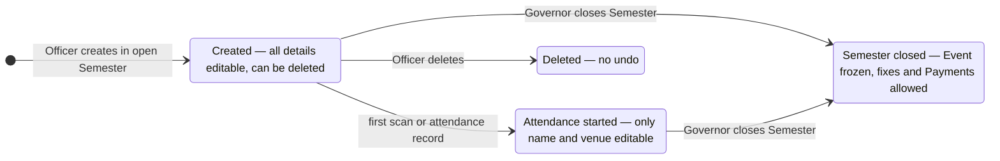

*Figure 7. Event lifecycle: what can be changed and when.*

| Event state | You can… | You cannot… |
| --- | --- | --- |
| Created, no scans yet | Edit everything; delete it | — |
| Attendance started | Edit name and venue; fix attendance; record Payments | Change date, type, or penalty; delete it |
| Semester closed | Fix attendance; record Payments | Edit or delete the Event |

> [!IMPORTANT]
> Deleting an Event cannot be undone. It is only allowed before anyone has been scanned for it.

### 7.3 Scanning at the booth (Android app)

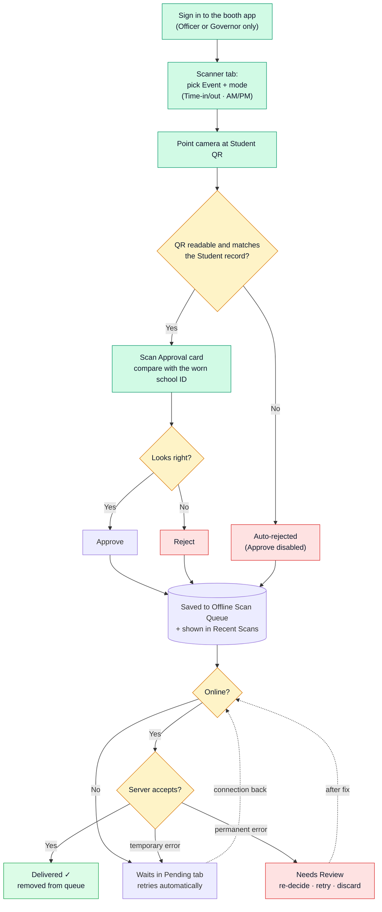

*Figure 8. Booth scanning flow with offline sync.*

The booth app has five tabs:

| Tab | Purpose |
| --- | --- |
| Scanner | Choose the Event and mode (Time-in AM, Time-out AM, Time-in PM, Time-out PM), then scan. Shows the last five decisions (Recent Scans). |
| Pending | Decisions waiting to sync, decisions that **Need Review**, and recent deliveries. A badge shows how many are unresolved. **Sync now** forces a retry. |
| Events | View, create, and edit shared Events from the phone. |
| Rejections | List of rejected scans. |
| Settings | Change the theme (light/dark) and log out. |

#### Step by step

1. Sign in with your school Google account. Only Officers and Governors can enter; Students are turned away.
2. On **Scanner**, choose the Event and the correct mode. **Every scan uses the selected mode**, so switch it when the session changes.
3. Point the camera at the Student's QR code (phone screen or printed QR Card).
4. The **Scan Approval** card shows the Student's name, Student ID, and Program. Compare them with the Student's **worn school ID**.
5. Tap **Approve** if they match, or **Reject** if they don't. Unreadable QR codes, or ones that don't match the current Student record, cannot be approved and are saved as rejections automatically.
6. The decision is saved on the phone straight away and syncs in the background.

#### Working offline

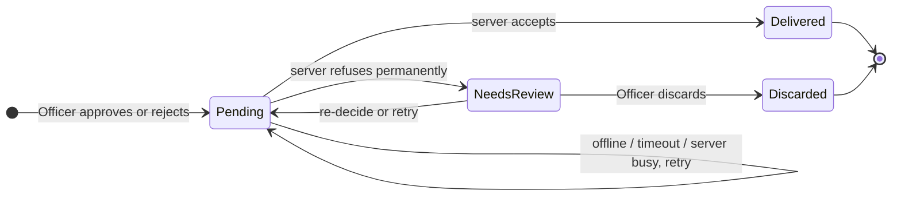

*Figure 9. States of a booth decision in the Offline Scan Queue.*

- Keep scanning when there is no signal. Every decision stays on the phone with the moment it was captured.
- The app retries on its own when the app opens, when the connection returns, and at increasing intervals.
- If a Student is scanned twice, the **earliest Time-in** and **latest Time-out** count, whatever order they sync in.
- **Needs Review** means the server permanently refused a decision. Open it on the Pending tab to switch approve/reject, retry it unchanged, or discard it. It does not block other decisions.

> [!IMPORTANT]
> You cannot log out while decisions are pending or need review. The queue belongs to you and cannot be moved to another Officer. Sync or resolve everything before handing over the phone.

### 7.4 Correcting attendance (attendance grid)

1. Open **Events**, choose an Event, and open its **Attendance** grid.
2. Each Time-in and Time-out cell is a **Present / Absent** dropdown. Change the cells that are wrong.
3. Penalties recalculate as soon as you save. A Penalty that is already paid stays paid, so its Payment record remains valid.
4. For unpaid Penalties, use **Mark paid** to record a Payment for the amount.

> [!NOTE]
> Manual corrections record presence only, not a real time. Use the booth for actual timestamps.

### 7.5 Students

- Search by name, email, or Student ID, and filter by Program or status.
- **Edit student** fixes a wrong Student ID or Program. This invalidates that Student's printed QR Cards.
- Select Students (or **Select all matching Students**) and generate **QR Cards** in bulk to print for Students without phones.

### 7.6 Clearance

1. Open **Clearance** and search for the Student by name, email, or Student ID.
2. If the outstanding balance is ₱0, the Student shows as **Cleared & Ready**. Sign their physical clearance paper.
3. If not, the page lists what is unpaid. Collect payment, record it, then sign.

> [!NOTE]
> The system only shows readiness. It does not store a digital signature. The signed paper is the record.

### 7.7 Finance

| Area | What you can do |
| --- | --- |
| SAF Fees | Record a Student's SAF Fee Payment. It must be paid in full, once per Semester. |
| Penalty Payments | Shows collected Penalties. Payments are recorded from the attendance grid or Clearance. |
| Expenses | **Record Expense** with description, date incurred, amount, and Category. Expenses can be voided but never edited or deleted. Voided ones stay visible for audit. Only possible while a Semester is open. |
| Department Fund | The running balance: collected SAF Fees + collected Penalties − Expenses, across all semesters. It never resets. |

> [!NOTE]
> If there are no Categories, the Expense form says "No Categories — ask the Governor to add one".

### 7.8 Reports

Open **Reports**, choose a **Report Type**, pick the Event, Student, or Semester, and generate the PDF. Reports are created fresh each time and are not stored.

| Report | Contents | Available |
| --- | --- | --- |
| Per-Event | Attendance totals and session breakdown for one Event, plus an AI summary | From the day after the Event |
| Per-Student | One Student's ledger for a Semester | Any time |
| Per-Semester | Aggregate attendance and penalty summary | Any time |
| Financial | Penalties charged vs. collected, SAF Fees, Expenses | Any time |

---

## 8. Governor Guide

> 🟪 **GOVERNOR** — Only Governors can use the Administration page. Governors can also do everything in Chapter 7, including the booth app.

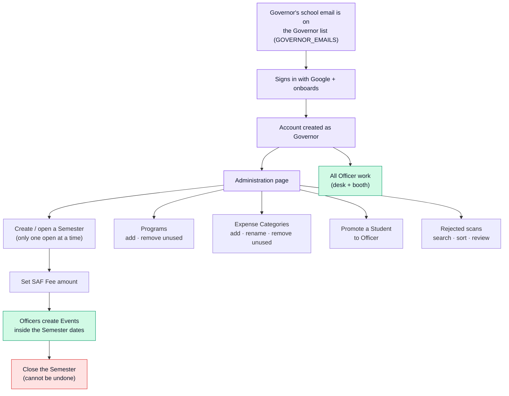

*Figure 10. Governor administration flow.*

### 8.1 Semesters

1. Open **Administration** and go to the Semester section.
2. Create a Semester with a start and end date and confirm **Initialize this Semester?**. Only **one** Semester can be open at a time.
3. Set the **SAF Fee** amount for the Semester. You can change it until the first SAF Fee Payment is recorded.
4. Edit dates (**Save this Semester?**) only if the new range still contains every existing Event.
5. At the end of the term, choose **Close this Semester?**.

> [!IMPORTANT]
> Closing a Semester cannot be undone from the app. It freezes Event creation and editing. Attendance fixes and Payment recording stay open so balances can still be settled.

A Semester can only be deleted (**Delete this Semester?**) while it has no Events.

### 8.2 Programs

- Add a Program (**Add this Program?**). Names must be unique. Standard Programs: Computer Science, Information Technology, Information System, and ACT (Associate in Computer Technology).
- Remove a Program only when no Student uses it.

### 8.3 Expense Categories

- Add categories such as supplies, food, honoraria, or transportation (**Add this Expense Category?**).
- Rename as needed. A category used by any Expense cannot be removed, so past records keep their classification.

### 8.4 Appointing Officers

1. In **Appoint executive officers**, search for a Student by name, email, or Student ID.
2. Confirm the promotion. The Student becomes an Officer with access to every shared Event, the booth app, Payments, and Clearance.
3. Ask the new Officer to sign out and back in to see the new menu items.

### 8.5 Reviewing rejected scans

Open **Administration → Rejections** to audit every rejected Scan Approval. Filter by Student or QR reference, sort by Student or scan time, and review the matched Student, the raw QR data, the Officer who decided, and the capture time. Repeated rejections for the same QR can point to a shared or stolen QR code. Rejected scans never change attendance.

---

## 9. Attendance, Penalty, and Clearance Rules

> ⬜ **ALL USERS** — These rules are enforced by the system for everyone.

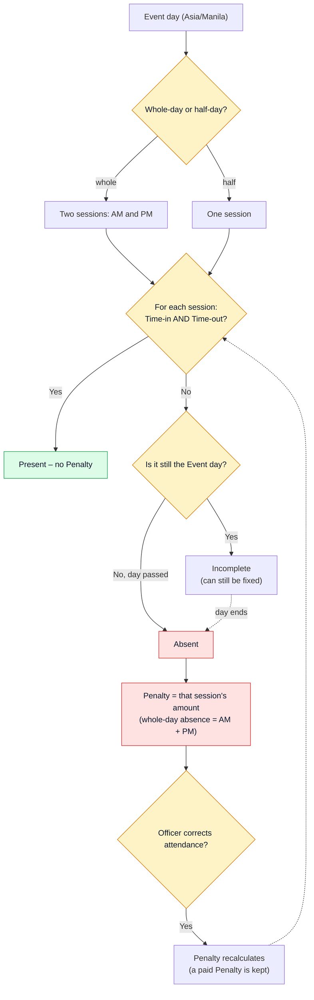

*Figure 11. How attendance becomes a Penalty.*

| Rule | Detail |
| --- | --- |
| One Event = one day | Every Event is on one Asia/Manila calendar date inside its Semester. |
| Session needs two scans | Time-in and Time-out are both required. Either one missing means absent. |
| Whole-day vs. half-day | Whole-day Events have separate AM and PM sessions. Half-day Events have one. |
| Penalties are automatic | Never typed in by hand. Recalculated whenever attendance changes. |
| Late registrants | Owe for every Event in the Semester they joined, including earlier ones. |
| No carry-over | Penalties belong to one Semester. Unpaid debt is handled by Clearance. |
| Full payment only | Each Payment settles one Penalty or one SAF Fee in full. No installments. |
| Payments are permanent | A Payment or Expense can be voided but never edited or deleted. |
| Clearance | Ready only when outstanding Penalties plus SAF Fee for the Semester is ₱0. |
| Department Fund | One continuous balance across all semesters: money collected minus money spent. |

---

## 10. Troubleshooting and FAQ

| Problem | Role | What to do |
| --- | --- | --- |
| Sign-in refuses my account | ⬜ All | Use your @gbox.ncf.edu.ph Google account, not a personal Gmail. |
| Onboarding says my Student ID doesn't match | 🟦 Student | Check the ID format (e.g. 24-00136) and that your Google name matches your school record. If it still fails, ask an Officer to check the roster. |
| My scan shows Incomplete | 🟦 Student | One of the two scans is missing. Get scanned out before leaving, or ask an Officer to correct it. |
| My printed QR Card was rejected | 🟦 Student | Your details were probably corrected after printing. Download a new QR Card. |
| I can't create an Event | 🟩 Officer | There may be no open Semester, or the date is outside it. Ask the Governor. |
| I can't change an Event's date or penalty | 🟩 Officer | Attendance has started, so only name and venue can change. |
| Scans are stuck in Pending | 🟩 Officer | Check the internet connection and tap Sync now. Decisions are safe on the phone until they sync. |
| A scan is in Needs Review | 🟩 Officer | Open it on the Pending tab and re-decide, retry, or discard it. |
| I can't log out of the booth app | 🟩 Officer | Pending or Needs Review decisions remain. Sync or resolve them first. |
| Administration page redirects me | 🟩 Officer | Administration is for Governors only. |
| Can't create a new Semester | 🟪 Governor | Another Semester is still open. Close it first. |
| Can't remove a Program or Category | 🟪 Governor | It is still in use by a Student or an Expense. |

---

## 11. Glossary

| Term | Meaning |
| --- | --- |
| Attendance Session | One half (AM or PM) of an Event for one Student. |
| Clearance | End-of-semester check that a Student owes ₱0 before an Officer signs their paper. |
| Department Fund | Cumulative cash balance: collected SAF Fees and Penalties minus Expenses. |
| Enrollment Roster | The semester's imported list of enrolled people. |
| Event | One day of activity requiring attendance, whole-day or half-day. |
| Expense | Money spent by the department, recorded with a Category. |
| Ledger | A Student's computed standing for a Semester: total charged and outstanding. |
| Needs Review | A booth decision the server refused; the Officer must re-decide, retry, or discard it. |
| Offline Scan Queue | Decisions saved on the Officer's phone until they sync. |
| Payment | A record that settles one Penalty or one SAF Fee in full. |
| Penalty | Peso charge for an absent Attendance Session, calculated automatically. |
| Pending Student | Signed in with a school account but has not finished onboarding. |
| QR Card | A printable copy of a Student's QR with name, ID, and Program. |
| Recent Scans | The last five decisions made on the booth phone. |
| SAF Fee | Per-Semester Student Assistance Fund charge, paid in full once. |
| Scan Approval | The booth screen where an Officer matches the QR details to the worn school ID. |
| Semester | Date range set by the Governor; only one is open at a time. |
| Time-in / Time-out | The arrival and departure scans for an Attendance Session. |
